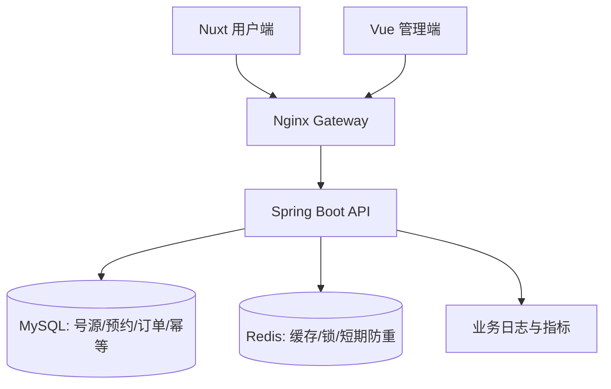

# 医院预约挂号系统高并发防超卖、Redis 缓存与容器化部署 PRD

> **版本**：V2.1  
> **日期**：2026-10-09  
> **状态**：已完成首轮代码审计，待完成业务与环境核验  
> **适用系统**：现有医院信息管理系统  
> **适用角色**：产品、后端、前端、测试、运维、Codex 开发代理  
> **实施方式**：基于现有代码增量改造，优先保障既有业务兼容性

## 0. 文档说明

### 0.1 版本记录

| 版本 | 说明 |
| --- | --- |
| V1.1 | 统一下单、MySQL 原子占号、Redis 锁、基础信息缓存、Docker Compose 五阶段方案 |
| V2.0 | 融合持久化幂等、database约束、支付生命周期、容器安全、故障策略、测试与 Codex 交付规范；统一前述冲突 |
| V2.1 | 根据现有仓库代码与初始化 SQL 审计修订：确立 MySQL 原子更新为唯一必选正确性保障，调整 Redis 锁故障策略与实施优先级，支付号源释放改为真实支付上线前的必选项 |

### 0.2 文档依据和事实边界

本 PRD 基于以下两份现有设计文档整合：

1. 《PRD-预约挂号防超卖与容器化部署》V1.1。
2. 《医院预约系统高并发与容器化优化 PRD》。

经仓库代码与初始化 SQL 审计，以下事实已确认：

- 后端为 Java 8、Spring Boot 2.5.15 的 Maven 多模块工程，包含 `lws-info`、`lws-order`、`lws-admin`；运行产物为 `lws-admin.jar`。
- 管理端使用 Vue 2，用户端使用 Nuxt 2 SSR。
- 主要数据表包括 `duty_info`、`appointments_info`、`order_info`，且均使用 InnoDB。
- 用户端目前先调用新增预约接口，再调用新增订单接口；第二步失败不会回滚第一步。
- 当前预约服务使用“查询已约数、内存加一、写回database”的方式，未形成统一事务或原子容量约束。
- 工程已接入 Spring Data Redis，但尚未引入 Redisson。
- 当前源码中的订单及预约状态值为：`0` 待支付、`1` 已支付／已预约、`2` 已取消、`3` 已退款；database SQL 注释中的订单取消值与代码不一致，迁移前必须以实际数据和代码常量复核。

本次审计未连接运行中的database或支付平台，故患者与登录用户的关系、生产 MySQL／Redis 版本、历史数据质量、真实支付规则及运行环境容量仍须在阶段 0 补充确认。示例 SQL、路径和接口名称均须以实际工程为准。

### 0.3 优先级定义

| 级别 | 含义 |
| --- | --- |
| P0 | 正确性或真实支付上线的必选项；阻断验收的问题不能带入下一阶段 |
| P1 | 提高可维护性、部署安全或性能；按本 PRD 的必选要求实施 |
| P2 | 额外增强或未来扩展，须有明确启用条件 |
| 条件必选阶段 | 可在演示环境单独排期；一旦接入真实支付或对外服务，即成为发布阻断项 |

---

## 1. 项目背景与问题

### 1.1 已识别的问题

1. **预约与订单创建割裂**：前端依次请求两个接口，订单失败时可能保留已占号预约。
2. **并发更新竞争**：先读后写的计数方式可能丢失更新，造成有效预约与号源容量不一致。
3. **缺少持久化幂等保障**：重复点击、客户端重试或多个请求并行可能重复占号。
4. **缺少可执行的缓存策略**：医院、科室、医生、排班等高频读取可能反复访问database。
5. **部署依赖本机配置**：database、缓存、后端、两个前端需独立准备，密钥与运行路径隔离不足。
6. **支付生命周期不完整的风险**：待支付订单如长期占号，需要明确取消、超时和释放规则。
7. **缺少量化回归验收**：原子占号、重复预约、Redis 故障和容器恢复尚需形成自动化证据。

### 1.2 业务使用场景

- 热门医生同一排班在短时间内收到大量预约请求。
- 患者重复点击提交按钮，或者网络中断后重新发送相同请求。
- 预约写入成功后订单创建失败，需要完整回滚。
- 管理员修改排班时间、挂号费、可预约数，展示缓存需要及时失效。
- 系统在全新开发机或演示服务器中一键启动并保留数据。
- 可选阶段：订单未支付而超时，或者支付回调与取消任务同时到达。

---

## 2. 目标、范围与成功标准

### 2.1 业务目标

1. **零超卖**：在任意并发竞争中，排班已占用数不得超过总号源。
2. **强事务一致性**：原子占号、预约记录、订单记录和持久化幂等结果在同一事务内完成。
3. **业务防重**：同一患者同一排班同时最多存在一个有效预约；同一请求重复执行返回同一业务结果。
4. **读性能优化**：稳定展示数据使用 Redis 缓存，号源权威数据仍由 MySQL 管理。
5. **统一部署**：一条 Docker Compose 命令启动所需服务，完成健康检查和持久化。
6. **可验证性**：提供自动测试、并发压测、故障注入和部署验证报告。

### 2.2 本次主版本范围

| 范围 | 核心要求 | 级别 |
| --- | --- | --- |
| 单一预约下单接口 | 后端一次请求完成占号、预约、订单 | P0 |
| MySQL 原子更新与事务 | 防超卖最终防线、失败回滚 | P0 |
| 重复预约与持久化幂等 | database唯一性保护、Redis 快速拦截 | P0 |
| Redisson 排班级分布式锁 | 热点排班削峰的可选优化；仅在压测证明收益后启用 | P1 |
| Redis 展示缓存 | 基础信息缓存、失效策略、空值和 TTL 抖动 | P1 |
| 剩余号源查询 | 默认 MySQL 实时查询；可选短缓存关闭 | P0 |
| Docker Compose | 六服务组合、配置隔离、网络、健康检查、数据卷 | P0 |
| 监控与测试 | 指标、并发、回滚、幂等、故障与部署检查 | P0 |
| 支付取消、退款与超时释放 | 演示环境可独立排期；真实支付上线前必须完备 | 条件必选 |

### 2.3 本期非目标

- 不引入 Kafka、RabbitMQ 或其他消息队列。
- 不实施 Redis 库存预扣或 Redis 与 MySQL 双库存同步。
- 不引入 Kubernetes、MySQL 主从、Redis Cluster 或跨机房高可用。
- 不重做既有登录、患者档案、权限、支付平台接入和无关业务页面。
- 不对既有工程做无关的大规模架构重构。
- 不提供未经实际压测的吞吐量或延迟保证。

### 2.4 可度量指标

| 指标 | 验收目标 |
| --- | --- |
| 号源超卖 | 0 次；database容量不变量始终成立 |
| 孤立订单／预约 | 新流程中 0 条；故障注入后事务完整回滚 |
| 同一 requestId 重放 | 只创建 1 组预约与订单；返回相同持久化结果 |
| 同患者同排班有效预约 | 最多 1 条，并且须由database层约束保护 |
| 号源读一致性 | 列表与确认页默认直接查询 MySQL 的当前已提交状态 |
| 基础信息缓存 | 第二次相同有效查询应可命中；命中率目标以实测为准，观察值建议 ≥60% |
| 预约接口性能 | 记录 P50、P95、P99、QPS 和锁等待；目标在阶段 0 建立机器规格与基线后确定 |
| 一键部署 | `docker compose up -d --build` 后核心业务完整可用 |
| 重启恢复 | MySQL、上传文件持久化；Redis 重启不影响database事实 |

**并发验收特别说明**：例如 100 个不同患者同时竞争剩余 10 个号源，成功数量必须不超过 10；在无故障、有限重试的测试中，应验证可用号源能被最终预约完。该验收以 MySQL 原子条件更新为基础，不以 Redis 锁是否启用作为前提。

---

## 3. 总体架构和技术决策

### 3.1 技术栈

| 层次 | 技术 | 职责 |
| --- | --- | --- |
| 用户端 | 现有 Nuxt 2 SSR | 排班展示、患者选择、统一下单、查看订单 |
| 管理端 | 现有 Vue 管理端 | 医院、科室、医生、排班、订单管理 |
| 应用层 | 现有 Spring Boot 模块 | 鉴权、业务校验、事务、幂等、缓存、订单 |
| database | MySQL / InnoDB | 号源、预约、订单、幂等请求权威数据 |
| 缓存与并发控制 | Redis + Redisson | 稳定数据缓存、热点锁、短期防重 |
| 接入层 | Nginx 网关 | 统一入口、反向代理、基础访问控制 |
| 容器化 | Docker + Docker Compose | 本地／单机演示部署与运行配置 |
| 验证工具 | JUnit 或当前测试框架、JMeter/k6 可选 | 事务、并发、接口、端到端测试 |

### 3.2 核心结构



图表示逻辑请求方向；实际容器中，`admin-web` 和 `site-web` 在 Gateway 后作为独立 Web 服务运行，浏览器通过 Gateway 同源访问。

### 3.3 不可违反的技术原则

1. **MySQL 是号源、有效预约和订单的唯一事实源。**
2. **MySQL 原子条件更新是最终防超卖保障。** 即使 Redis 锁失效、过期或被绕过，database也应保持容量约束。
3. **分布式锁不是正确性前提。** 如压测后启用，锁以 `scheduleId` 为粒度，不使用全院锁或全局锁。
4. **Redis 幂等是优化，database持久化幂等是最终约束。**
5. **database事务提交成功后才能使缓存失效。**
6. **剩余号源与基础资料分开读取。** 缓存不会决定预约是否成功。
7. **保持增量开发。** 保留管理端必要能力，但任何对外预约入口都不得绕开统一事务。
8. **业务发布不得回滚到存在超卖风险的旧预约入口。**

### 3.4 Redis 故障策略的统一决策

| 场景 | 默认行为 | 允许的后续优化 |
| --- | --- | --- |
| Redis 展示缓存失联 | 有界回源 MySQL；记录告警；避免无上限回源 | 熔断、限流、短期本地缓存可独立评估 |
| 分布式锁 Redis 失联 | 默认绕过锁，依赖 MySQL 原子条件更新和database幂等继续处理；database压力异常时限流或返回系统繁忙 | 经压测后可按部署环境切换为失败关闭，但不得取消database正确性保障 |
| Redis 幂等快速拦截失联 | 继续依赖database持久化幂等处理；Redis 不可用不得导致重复下单 | 必须验证并发双请求不会重复下单 |
| MySQL 不可用 | 新预约失败；不得改由 Redis 独立确认成功 | 无 |

**配置约束**：`appointment.lock.enabled=false` 为初始默认值；只有阶段 3 压测证明锁能改善热点排班的容量利用率、P95/P99 或database压力时，才允许在受控环境启用。Redis 故障时默认使用database保障链路；当database已达到经验证的保护阈值时，应用限流或快速失败。配置名称为建议命名，按现有项目风格落地。

---

## 4. 业务规则与状态模型

### 4.1 核心业务规则

- 一个排班以 `scheduleId` 唯一标识，包含总可预约数与当前占用数。
- 一个有效预约对应一个患者和一个排班。默认规则：同一患者同一排班最多一个有效预约。
- 每个新预约意图生成新的 `requestId`；重试同一意图必须复用原 `requestId`。
- 订单价格从database排班／定价配置读取，前端金额不可作为权威值。
- 预约必须校验登录用户与所选患者的关联权限、排班开放状态、挂号截止时间。
- 取消后是否允许再次预约：**V2.1 默认允许新 `requestId` 重新预约，但须经过阶段 0 的现有业务规则核实。**
- 已预约数定义为**当前仍占用号源的有效预约数量**，包含待支付占号订单及已支付且仍有效的订单；取消并完成释放的记录不计入。现有database若语义不同，阶段 0 需确定迁移或映射方案。

### 4.2 状态约束

源码审计已确认当前状态值；正式迁移前仍须以运行库数据和支付平台规则复核，禁止只依据历史 SQL 注释判断。

| 对象 | 建议逻辑状态 | 有效迁移 |
| --- | --- | --- |
| 预约 | `0` 待支付占号、`1` 已预约、`2` 已取消、`3` 已退款 | 创建→待支付占号；支付成功→已预约；超时／主动取消→已取消 |
| 订单 | `0` 待支付、`1` 已支付、`2` 已取消、`3` 已退款 | 待支付→已支付或已取消；退款流程独立核实 |
| 幂等请求 | 已成功、失败可重试或处理中 | 一次业务事务成功后记录成功结果；失败时不保留伪成功 |

**主版本和条件必选阶段的边界**：前两阶段先完成“创建预约”的原子链路与database正确性保障；后续阶段依次评估锁、缓存和容器化。支付取消、退款与超时释放可在无真实支付的演示环境独立排期；一旦接入真实支付或对外服务，即为发布阻断项。若无法正确释放已取消或长期未支付订单占用的号源，系统不得作为真实支付环境上线。

---

## 5. 功能需求

### FR-01 统一挂号下单接口 — P0

**目标**：一个后端接口取代前端“创建预约→创建订单”的两次调用。

**建议接口**：`POST /order/registeredOrder`。实际 URL、Controller、Service 及权限体系由阶段 0 审计确定。

请求体：

```json
{
  "scheduleId": 10001,
  "patientId": 20001,
  "requestId": "8fd8a944-16b9-4f06-b1cf-986a3aa2ac66"
}
```

- `scheduleId`：必填，排班标识。
- `patientId`：必填，患者标识。
- `requestId`：必填，客户端为一次预约意图生成的 UUID 或等效唯一值。
- `userId`：仅由登录态解析，不允许前端指定任意用户身份；必须在阶段 0 确认订单用户与患者档案的实际关联关系。
- `orderAmount`、`orderId`、`appointmentsId`、`payState`：均不得作为可信前端写入字段。

响应示例，字段名和现有 API 封装统一：

```json
{
  "orderId": 30001,
  "appointmentsId": 40001,
  "orderAmount": "50.00",
  "payState": "PENDING",
  "requestId": "8fd8a944-16b9-4f06-b1cf-986a3aa2ac66"
}
```

`payState` 为逻辑示例值，必须适配现有枚举；仅在第六阶段实现后增加 `paymentDeadline` 返回字段。

**执行要求**：

1. 解析登录用户，验证患者归属、请求参数和排班开放状态。
2. 规范化业务参数并计算请求指纹，用于识别相同 `requestId` 携带不同参数的情况。
3. 命中历史已成功幂等请求时返回原业务结果；若参数指纹不同则拒绝。
4. 如已根据压测启用 Redisson，按 `scheduleId` 获取分布式锁；未启用时直接进入database事务。
5. 在database事务内持久化唯一幂等请求，校验有效预约约束。
6. 原子更新排班占号数；仅成功更新时继续。
7. 写入预约与订单，关联幂等请求与生成结果。
8. 完成database提交；随后触发缓存失效。
9. 如持有锁，在事务完成后安全释放；返回订单和预约信息。

**异常要求**：任意database写入失败全部回滚；若事务提交结果因网络中断无法确定，客户端继续使用原 `requestId` 查询／重试，后端返回持久化的真实状态，不得盲目重复下单。

### FR-02 原子占号与统一事务 — P0

示意 SQL：

```sql
UPDATE duty_info
SET appointments_num_made = appointments_num_made + 1,
    update_time = NOW()
WHERE schedule_id = :scheduleId
  AND del_flag = '0'
  AND appointments_num_made < appointments_num;
```

database表名和字段以阶段 0 审计为准。如果排班开放状态、停止挂号时间属于同表可加入 SQL 条件；若存在跨表校验，应先完成鉴权和业务校验，并通过最终更新约束或相应锁定策略排除管理员同时修改的竞态。

- 影响行数为 1：占号成功。
- 影响行数为 0：在重新核查排班状态后区分“无号、已停诊、排班不存在”等错误。
- 以下写入需处于同一个database事务：**幂等请求最终结果、排班号源、预约、订单**。
- Spring 事务应覆盖运行时和受检异常；锁在事务提交完成后释放。
- 禁止在database事务中执行耗时第三方支付网络调用。
- 管理员减少总号源数时，必须保证修改后总量仍大于或等于当前占用数。

事务形式：

```text
可选：Redis 锁获取（仅压测确认后启用）
  └─ TransactionTemplate / 独立代理事务方法
      ├─ 确保持久化幂等唯一性
      ├─ 校验业务与有效预约
      ├─ UPDATE 原子占号
      ├─ INSERT appointments_info
      ├─ INSERT order_info
      └─ 事务提交
  └─ 事务完成后缓存失效
可选：Redis 锁释放
```

**禁止**事务内部开启锁，而在事务提交之前释放锁。事务异常由事务管理器回滚，外层 `finally` 负责安全解锁。

### FR-03 分布式锁与热点控制 — P1（压测准入）

| 参数 | 默认设计 |
| --- | --- |
| 组件 | Redisson，版本与当前 Spring Boot/JDK 兼容；不作为防超卖或幂等的必要组件 |
| Key | `his:{env}:lock:appointment:schedule:{scheduleId}` |
| 粒度 | 每个 `scheduleId` 一把锁 |
| 获取锁等待 | 初始建议 200–500ms，由压测调整 |
| 锁有效期 | **优先使用 Redisson 续期机制**，不得随意使用不足以覆盖事务 P99 的固定 3–5 秒租约 |
| 解锁 | `finally` 中确认当前线程持有锁再解锁 |
| 获取失败 | 可直接进入database保障链路；若限流已触发，返回“系统繁忙／请重试”且不创建订单 |
| 可靠性 | MySQL 原子条件更新始终保留；锁不参与最终库存裁决 |

实施前必须先完成“仅 MySQL 原子更新”基线压测。只有在热点排班下出现可观的database行锁等待、连接池压力或尾延迟，并且 Redisson 能带来可量化收益时，才引入锁。实施时须验证所选 Redisson API 的续期语义；如果显式传入固定 leaseTime，需用故障注入覆盖长事务和锁过期。增加按排班锁竞争指标和锁等待耗时记录。

压测须比较“仅使用 MySQL 原子更新”与“开启 Redisson 锁”两种模式的成功率、P95/P99、MySQL 行锁等待与database连接池压力。锁只在结果明确改善且不造成不可接受少卖时启用；默认开发、演示与验收环境关闭锁，以验证database保障链路可独立正确运行。

### FR-04 持久化幂等与重复预约保护 — P0

**第一层：客户端与 Redis 短期拦截**

- 前端按钮提交时短暂禁用，网络重试复用同一个 `requestId`。
- Redis 可保存短期处理中标识或成功结果缓存，但必须有 TTL，不用于最终判定是否创建过订单。
- Key 示例：`his:{env}:idempotency:appointment:{userId}:{requestId}`。
- Redis 处理中的 TTL 根据最长请求耗时与失败恢复窗口配置，例如 30–60 秒；成功结果缓存可更长，database持久化记录不受其过期影响。

**第二层：database持久化幂等**

- 新增可审计的幂等请求记录表，或在现有可承担相同职责的表中新增字段。
- 强制唯一约束：`(user_id, request_id)`。
- 保存：请求指纹、业务类型、最终预约 ID、订单 ID、处理结果、创建／更新时间。
- 对相同用户、相同 `requestId`：请求指纹一致且已成功时返回原订单结果；不一致时返回参数冲突。
- 并发相同请求由database唯一约束与事务正确仲裁；不可通过“先 SELECT 再 INSERT”作为唯一防重手段。
- 推荐让幂等插入与业务创建处于同一事务，避免提交后仅留下无法重试的处理中记录；database唯一键冲突时查询已提交的既有结果。若首次事务回滚，请求可正常重试。

**第三层：同一患者同一排班有效预约约束**

- 业务层检查现有有效预约。
- database层必须提供等效的唯一性保障，防止不同 `requestId` 的竞争请求同时通过检查。
- 不直接建立永远有效的 `(schedule_id, patient_id)` 唯一索引，否则可能阻止取消后的再次预约。
- 若使用 MySQL，可根据实际状态码设计“仅有效状态参与唯一性”的生成列＋唯一索引，或者采用独立的活动占号关联表；具体迁移设计由阶段 0 审计确定。
- 历史重复记录须先清理／制定迁移方案，再创建新约束。

### FR-05 历史入口与权限保护 — P0

- 用户端 `booking.vue` 改为仅调用统一预约接口；实际路径由阶段 0 核实。
- 旧“直接创建预约”和“直接创建订单”接口不得作为患者可访问的独立占号入口。
- 如管理端确需保留，必须进行身份鉴权、角色权限检查，并复用同一占号与事务服务，避免绕过database约束。
- 保留旧代码供审计和受控兼容，但不可作为上线时绕过事务的回滚通道。
- 受影响的订单查询、取消、退款、支付回调应进行回归审查，防止从其他入口意外增减号源。

### FR-06 Redis 展示缓存 — P1

**缓存原则**：Cache Aside；基础展示数据可缓存；最终号源、订单状态和预约结果来自 MySQL。

| 数据 | Key 示例 | TTL 初始建议 | 说明 |
| --- | --- | --- | --- |
| 医院信息 | `his:{env}:hospital:{code}` | 30–60 分钟 | 更新后精确删除 |
| 科室信息 | `his:{env}:department:{id}` | 30–60 分钟 | 更新后精确删除 |
| 医生信息 | `his:{env}:doctor:{id}` | 30–60 分钟 | 更新后精确删除 |
| 数据字典 | `his:{env}:dictionary:{type}` | 1–6 小时 | 根据现有查询需求启用 |
| 排班基础列表 | `his:{env}:schedule:base:{hospital}:{dept}:{date}` | 5–10 分钟 | 不包含动态余号 |
| 排班基础详情 | `his:{env}:schedule:detail:base:{scheduleId}` | 5–10 分钟 | 不包含动态余号 |
| 不存在的基础信息 | 对应 Key 的空值标记 | 30–60 秒 | 防穿透，需校验业务不存在 |
| 剩余号源列表 | `his:{env}:schedule:availability:{hospital}:{dept}:{date}` | **默认关闭** | 压测确有必要时启用 1–3 秒短缓存 |

**读取流程**：

```text
查基础信息 Redis → 未命中则 MySQL → 回写 TTL＋随机抖动
查询排班号源 MySQL 已提交状态 → 合并展示 → 返回用户端
```

- 列表页和确认页默认实时查询剩余号源；确认页始终实时查询。
- 列表页如压测确有必要可启用 1–3 秒快照缓存，默认关闭；其随机抖动不得导致总 TTL 超过 3 秒。
- 展示余号只能辅助选择，预约最终必须经过原子条件更新。
- 排班基础信息变更完成提交后删除关联详情、列表缓存；当医生、科室等变化影响组合列表时同步删除受影响 Key。
- 预约成功仅使**可选余号缓存**失效；不删除未变化的排班基础信息缓存。
- 取消或释放号源同样删除可选余号缓存。
- 缓存删除失败应记录指标与告警，不能反向回滚已提交成功的订单。依赖短 TTL 和可选延迟二次删除或版本方案控制旧值重建风险。
- 不在生产请求中使用 `KEYS` 扫描清理缓存。
- 热点不存在值短时间缓存空标记，必须区分空结果与 Redis 故障。
- 基础缓存 TTL 加入受控随机抖动，降低同时过期；同一 Key 的并发回源须有有界保护。

**Redis 容量约束**：锁、缓存和幂等短键同实例部署时不得使用可能任意驱逐锁键的 LRU 策略。演示环境可设置 `noeviction` 并设置内存告警、TTL 与容量保护；缓存写入失败应被捕获并安全回源。生产高并发可评估拆分锁实例和缓存实例。

### FR-07 Docker Compose 一键部署 — P0

**服务拓扑**：

| 服务 | 实现形式 | 数据／端口要求 |
| --- | --- | --- |
| `gateway` | Nginx | 唯一默认公网入口，80/443；反向代理和静态访问 |
| `backend` | Spring Boot / JRE | 内网访问，连接 MySQL/Redis |
| `admin-web` | Vue 静态构建 + Nginx | 网关代理管理端，不直接映射公网 |
| `site-web` | Nuxt 2 SSR / Node | 网关代理用户端，保留 SSR |
| `mysql` | 兼容现有 SQL 的 MySQL | 内部网络、命名卷、健康检查、备份恢复 |
| `redis` | 兼容当前客户端的 Redis | 内部网络、认证、健康检查、受控持久化 |

**部署细则**：

1. 后端多阶段构建：与现有工程兼容的 Maven/JDK 构建镜像，精简 JRE 运行镜像；阶段 0 确认是否确为 JDK 8。
2. 管理端多阶段构建，运行镜像仅携带构建后的静态文件。
3. Nuxt 用户端保留 SSR，区分服务端内部 API 地址和浏览器公开访问地址；尽量通过 Gateway 使用同源 `/api` 路径，避免构建期写死宿主机地址。
4. Compose 配置内部网络、服务依赖健康条件、重启策略、CPU/内存限制、日志滚动、上传目录与database数据卷。
5. MySQL 与 Redis 不默认向宿主机发布数据端口；后端和前端内部服务也由 Gateway 代理。
6. database初始化 SQL 仅在首次创建空卷时自动执行；升级采用可审查的迁移脚本，禁止启动时无条件覆盖业务数据。
7. 提供 `.env.example` 但不得提交真实 `.env`、JWT 密钥、database密码和支付密钥；生产环境优先使用受控密钥文件／密钥管理机制。
8. Redis 身份认证、MySQL 账户权限按最小权限配置；生产环境关闭或限制 Swagger、调试端点。
9. 提供后端轻量健康端点；Compose `depends_on` 配合健康检查，服务内部仍需具备有限次数的连接重试。
10. 镜像使用明确版本，避免生产依赖不可追踪的 `latest`。
11. MySQL 和上传目录必须有备份与恢复验证；Redis 可配置 AOF，但其数据不得承担订单事实源职责。
12. 在 Windows 开发环境与 Linux 容器之间排查本地硬编码路径、大小写差异、时区、字符集与文件权限问题。

**项目根目录提供**：

```text
Dockerfile / 各模块 Dockerfile
compose.yaml 或 docker-compose.yml
.env.example
.dockerignore
nginx 配置
README-DEPLOY.md
database初始化／迁移脚本
部署验证脚本或清单
```

**主验收命令**：

```bash
docker compose up -d --build
docker compose ps
docker compose logs --tail=100
```

若镜像已经构建，可使用 `docker compose up -d` 启动。README 必须说明首次构建、启动、重启、database初始化、迁移、备份与恢复步骤。

### FR-08 业务日志、监控和异常分类 — P1

- 每次下单关联同一 `requestId` 与服务端关联 ID；日志记录排班 ID、患者内部 ID、原子更新行数、事务结果、锁等待耗时、缓存失效结果。
- 指标包括：预约请求 QPS、成功率、无号率、锁超时率、重复请求命中率、P50/P95/P99、MySQL 行锁等待、连接池用量、Redis 错误率和内存、容器状态。
- 敏感字段脱敏：不得记录完整身份证号、患者姓名和手机号等个人敏感数据，也不得记录令牌、database密码、支付密钥。
- 错误码区分：排班不存在、停止挂号、号源已满、重复预约、请求重复且参数不一致、锁超时、服务不可用、database写入失败。
- 事务提交不确定时返回允许安全重试的错误提示与 `requestId`，避免直接返回“确定失败”造成用户重复提交。

---

## 6. database与接口变更设计

### 6.1 表结构影响

| 对象 | 变更内容 | 说明 |
| --- | --- | --- |
| `duty_info` | 原子条件更新、必要索引、容量变更保护 | 保持业务字段语义一致 |
| `appointments_info` | 统一服务创建、有效预约约束 | 核实取消状态与历史数据 |
| `order_info` | 统一服务创建、关联 requestId 或幂等结果 | 真实支付上线前必须具备支付截止时间与状态条件更新能力 |
| 幂等请求表或等效字段 | 新增持久化请求记录、`(user_id,request_id)` 唯一索引 | 必选；可复用现有机制，避免重复建模 |
| 有效预约约束结构 | 状态条件唯一索引或独立活动预约关联结构 | 必选；方案由既有database状态码决定 |

### 6.2 迁移与存量数据

1. 扫描历史同一患者同一排班的重复有效预约。
2. 扫描占号数与有效占号记录不一致的排班。
3. 扫描孤立预约、孤立订单及无效关联。
4. 制定可回溯的历史数据清理脚本，**默认仅报告，不自动删除或修改真实数据**。
5. 先备份、验证、迁移，最后启用唯一约束和新预约入口。
6. database迁移使用项目现有工具；若未使用迁移框架，提供独立 SQL 与执行／回滚说明。

### 6.3 接口清单

| 接口类别 | 变更 |
| --- | --- |
| 统一预约接口 | 新增并成为唯一患者下单入口 |
| 原新增预约／订单接口 | 对患者关闭直接写入路径；管理端受控兼容 |
| 医院、科室、医生查询 | 接入基础信息缓存 |
| 排班查询 | 基础资料读缓存、余号读 MySQL |
| 管理端排班维护 | 加入容量合法性检查和提交后失效逻辑 |
| 已有订单支付／取消 | 进行状态与号源变更回归测试，并保证取消、退款与超时释放号源至多一次 |
| 支付截止与关闭任务 | 无真实支付时可独立验收；真实支付上线前必选 |

---

## 7. 六阶段实施计划

### 阶段 0：项目审计与基线确认 — 必须先完成

**开发任务**

1. 识别 Maven 模块依赖、Spring Boot/JDK 版本、MySQL/Redis 版本及构建命令。
2. 定位 `booking.vue`、预约 Controller/Service、订单 Controller/Service、排班更新 Mapper。
3. 确认上述表结构、主键、索引、逻辑删除、已有状态枚举与取消／支付流程；复核 SQL 注释、代码常量和实际数据是否一致。
4. 识别旧接口对管理端、患者端及第三方调用者的实际依赖。
5. 提供能够复现现有问题的最小用例，记录当前部署方法和接口性能基线。
6. 确认登录用户、患者档案、预约和订单的关联关系，明确统一下单接口中 `patientId` 与订单 `userId` 的取值来源。
7. 评估是否已有幂等表、唯一索引、Redis 客户端和安全配置；核查已入库的密钥、支付私钥和本机硬编码路径。

**交付物**：`docs/CODE_AUDIT.md`、`docs/IMPLEMENTATION_PLAN.md`、现有流程图、风险清单、database迁移草案。

**通过门槛**：每一项设计对应具体代码位置；发现 PRD 与代码不符时先登记差异，再调整实施方案，不直接猜测字段和值。

### 阶段 1：统一下单与database事务 — P0

**开发任务**

1. 新增统一下单接口及 Service 编排。
2. 后端校验患者归属、排班和定价，并创建预约／订单。
3. 在单事务中使用 MySQL 原子条件更新处理号源占用，并持久化预约／订单。
4. 建立事务失败回滚测试；在阶段 2 的持久化幂等与有效预约约束完成前，不得切换患者端或关闭旧入口。
5. 阶段 2 验收通过后，用户端改为一个请求；旧入口限制权限或复用统一服务。

**验收**：正常预约创建一组合法数据；任意插入点抛异常，全部回滚；原子占号失败不产生预约或订单。

### 阶段 2：database防超卖和持久化幂等 — P0

**开发任务**

1. 引入持久化 `requestId` 唯一约束和请求指纹。
2. 增加有效预约database层唯一性约束与历史数据迁移脚本。
3. 处理重复请求返回原结果、相同 ID 不同参数冲突、取消后新请求规则。
4. 完成高并发database压力测试和异常注入。
5. 切换患者端至统一接口，并关闭或复用旧的直接写入入口。

**验收**：单排班多患者竞争不超卖；相同请求无重复记录；不同请求 ID 的同患者同时下单也至多有一条有效预约。

### 阶段 3：热点锁评估与短期防重 — P1（压测准入）

**开发任务**

1. 建立仅使用 MySQL 原子更新的并发与故障基线。
2. 仅当热点排班压测证明存在实际收益时，按 `scheduleId` 实现 Redisson 锁，覆盖完整事务提交。
3. 如启用锁，实现安全释放、锁超时与续期策略。
4. 增加 Redis 幂等短键和重复点击保护，DB 幂等仍为最终约束。
5. Redis 故障时默认继续使用database保障链路；database超过保护阈值时再应用限流或快速失败。
6. 对比锁启用／关闭的并发压测结果，重点分析容量利用率、P95/P99、行锁等待与连接池压力。

**验收**：不开启锁时已可保证不超卖和幂等；如启用锁，锁异常或到期无法造成超卖，且压测指标优于基线；Redis 故障时无重复下单或部分写入。

### 阶段 4：Redis 基础信息缓存 — P1

**开发任务**

1. 缓存医院、科室、医生、排班基础信息及需要的数据字典。
2. 列表页与确认页默认实时读取 MySQL 余号，避免缓存动态号源。
3. 实现 Cache Aside、提交后删除、空值缓存、TTL 抖动、故障降级。
4. 添加缓存指标和缓存一致性测试。
5. 留出默认关闭的 1–3 秒余号列表快照配置，**不得在无证据情况下开启**。

**验收**：命中缓存减少database基础信息读取；管理端更新后读取新值；预约结果与缓存故障隔离。

### 阶段 5：Docker Compose 部署与端到端验收 — P0

**开发任务**

1. 完成各模块 Dockerfile、Gateway 和 Compose 服务编排。
2. 完成database、Redis、文件数据卷、密钥隔离、内网隔离及健康检查。
3. 提供部署说明、示例环境变量、初始化与迁移脚本。
4. 验证首次部署、服务重启、缓存故障、database不可用、完整回归。
5. 生成测试证据、构建状态、已知限制及使用说明。

**验收**：从新环境执行一条 Compose 构建启动命令后，登录、浏览排班、预约、查看订单、管理端维护均可用；重启不丢失应持久化数据。

### 阶段 6：支付取消、退款、超时关闭与号源释放 — 条件必选阶段

**适用条件**：系统需要完整支付生命周期、接入真实支付、对外提供预约服务，或需解决长期未支付占号风险。无真实支付的本地演示可单独排期；其他场景为上线前必选。

**开发任务**

1. 保存订单支付截止时间；建议可配置初值 15 分钟，业务最终确认。
2. 待支付→已支付与待支付→已取消分别使用带原状态条件的database更新。
3. 定时任务幂等扫描已超时订单；取消预约和释放一个占用号源同事务完成。
4. 支付成功、取消、超时任务同时竞争时只有一个能进入终态并执行相应号源动作。
5. 对支付平台回调核验签名、金额和商户订单号；迟到回调应基于支付平台查询、退款／人工处理政策安全解决，避免把已释放号源重新确认为有效预约。
6. 为超时扫描设置索引；多实例任务重复执行仍然安全。
7. 如果项目只是个人演示且无真实平台，可使用明确标识的模拟支付回调和模拟时钟，不得宣称完成真实支付平台集成。

释放示意 SQL，需按实际字段重写：

```sql
UPDATE duty_info
SET appointments_num_made = appointments_num_made - 1
WHERE schedule_id = :scheduleId
  AND appointments_num_made > 0;
```

该 SQL **只能在订单状态条件更新成功、当前请求确实拥有释放资格后，在同一个事务中执行**。禁止重复取消时再次执行，禁止支付成功后被超时任务释放。

**验收**：超时只释放一次；重复支付回调无重复写入；支付与超时竞争结果唯一；无负号源或号源不一致。

---

## 8. 测试矩阵与验收标准

### 8.1 功能、事务与幂等

| ID | 测试用例 | 通过条件 |
| --- | --- | --- |
| AC-01 | 单用户预约 | 一次请求生成一个预约、一个订单，占号加一 |
| AC-02 | 号源耗尽 | 返回无号，database无新增业务记录 |
| AC-03 | 排班关闭或删除 | 拒绝新预约，号源不变 |
| AC-04 | 订单插入失败 | 占号、预约、幂等成功结果全部回滚 |
| AC-05 | 预约插入失败 | 占号和幂等成功结果回滚 |
| AC-06 | 相同 requestId 重试 | 返回原订单，记录总数不变 |
| AC-07 | 相同 requestId、参数不同 | 拒绝且可追踪，不新增预约 |
| AC-08 | 同患者不同 requestId 并发 | 同排班最多一条有效预约 |
| AC-09 | 伪造患者 ID | 未通过患者归属校验，无法下单 |
| AC-10 | 伪造订单金额 | 无法改变服务端定价 |
| AC-11 | 原患者旧预约接口 | 无法绕过统一事务与号源约束 |
| AC-12 | 管理员降低号源总量 | 不允许新总量低于现有占用数 |

### 8.2 并发和容错

| ID | 场景 | 验收标准 |
| --- | --- | --- |
| AC-13 | 剩余 1 号，100 个不同患者并发 | 最多 1 个新有效预约；绝无超卖与孤立数据 |
| AC-14 | 剩余 10 号，100 个不同患者并发 | 最多 10 个新有效预约；失败原因正确分类 |
| AC-15 | 支持重试的容量利用率测试 | 在无新增异常和合理时间窗口内，剩余号源可被后续合法请求预约，不出现永久少卖 |
| AC-16 | 长事务超过普通锁租约 | 锁续期或database安全兜底有效，无超卖 |
| AC-17 | 分布式锁获取超时 | 快速返回系统繁忙，无部分写入 |
| AC-18 | Redis 故障 | 默认新预约失败、读缓存有界降级；database数据不损坏 |
| AC-19 | 受控 DB_FALLBACK 模式 | 先满足限流／压测准入；降级后仍零超卖且幂等有效 |
| AC-20 | 同时更新排班总量与预约 | 最终容量约束不被打破 |

### 8.3 缓存与部署

| ID | 场景 | 验收标准 |
| --- | --- | --- |
| AC-21 | 基础信息重复访问 | 第二次有效请求命中 Redis；读取值准确 |
| AC-22 | 管理端修改医生／排班 | 提交后对应缓存失效，不长期返回旧资料 |
| AC-23 | 列表与确认页余号 | 默认来自 MySQL 当前已提交数据，提交结果仍以原子更新为准 |
| AC-24 | Redis 缓存不可用 | 有界回源，核心database记录保持一致 |
| AC-25 | Compose 全新启动 | 六服务按设计启动，健康状态可识别，核心链路可用 |
| AC-26 | Docker 重启与恢复 | MySQL 和上传文件数据按约定保留，恢复步骤可执行 |
| AC-27 | 端口与密钥审计 | database／Redis 不对公网暴露；源码、镜像、Compose 不含生产密钥 |
| AC-28 | Windows 到 Linux 容器迁移 | 路径、时区、字符集和 SSR API 均正常 |

### 8.4 第六阶段专属验收

| ID | 测试用例 | 通过条件 |
| --- | --- | --- |
| AC-29 | 待支付超时 | 订单取消且恰好释放一个号源 |
| AC-30 | 重复运行超时任务 | 不重复归还号源 |
| AC-31 | 支付回调与超时任务并发 | 只有一方成功转移待支付状态 |
| AC-32 | 支付成功后超时任务运行 | 已支付订单保留号源，不得被错误关闭 |
| AC-33 | 支付成功回调重复发送 | 结果幂等，不重复处理订单 |

### 8.5 测试证据

- 单元测试和集成测试命令、运行记录与通过数。
- 100 并发等测试的场景参数、机器配置、结果分类、database最终校验 SQL。
- Redis 停机及恢复测试记录；MySQL 断连与容器重启记录。
- 缓存命中率、锁超时、接口 P95/P99、慢 SQL 和database行锁等待数据。
- Compose 服务状态、容器日志，以及手工端到端操作记录。
- 所有失败用例的原因、修复提交和复测结果。

---

## 9. 安全、运维与发布要求

### 9.1 安全与隐私

- 所有预约接口必须完成登录和患者归属检查。
- 任何金额、号源容量、订单状态均由服务端读取和控制。
- database、Redis 内网访问、最小权限、身份认证。
- 禁止在 Git、Docker 镜像或 Compose 明文提交真实凭据。
- 当前已提交到仓库的 JWT、支付私钥、支付公钥及回调地址均按已暴露处理；容器化或真实部署前必须完成凭据轮换，并将新凭据移至受控运行时配置，不得复制到新配置。
- API 文档、管理端点、调试日志在非开发环境限制访问。
- 初始化 SQL 或测试数据中的患者信息必须采用合规模拟／脱敏数据。

### 9.2 可观测性与告警

建议设置如下告警条件，阈值由实际压测确定：

- 任何排班 `appointments_num_made > appointments_num`：严重正确性告警。
- 有效占号数与计数字段持续不一致：严重数据告警。
- Redis 锁获取失败率异常、连接池耗尽、MySQL 行锁等待升高。
- 订单、预约写入失败率异常。
- 缓存大面积失效、database读 QPS 突增。
- 容器频繁重启、磁盘余量不足、database备份失败。

### 9.3 发布顺序与回滚

1. 发布前备份database并保留可验证的恢复过程。
2. 清点旧预约入口与历史数据异常；分批实施兼容database迁移。
3. 新后端先发布并验证统一事务；新前端再切换单接口。
4. Redis 锁与缓存分别具备受控配置开关；缓存或锁问题可以回源database，但 MySQL 原子更新、事务和持久化幂等不可被简单回滚。
5. 网关与 Docker 配置先在演示环境完成测试，再应用至正式环境。
6. 回滚应用版本必须保留新增的正确性约束；禁止重新启用曾导致超卖或孤立订单的旧流程。
7. 第六阶段支付状态与新增字段上线采用单独迁移和回滚策略，确保老订单的处理兼容。

---

## 10. 开发代理 Codex 的执行规范

### 10.1 实施原则

- 按阶段 0→5 顺序开发；阶段 6 在无真实支付的演示环境可另行启用，在真实支付或对外服务环境必须在发布前完成。
- 先读取现有代码、配置和表结构，审计通过后才修改实现。
- 优先修改现有模块，避免无关依赖升级和架构重写。
- 不得凭 PRD 示例推断不存在的字段、支付枚举、接口和目录。
- 不得删除现有管理业务或擅自改写database存量数据。
- 编写或修改database结构前，先提交迁移方案和历史数据兼容分析。
- 每一阶段附测试、代码变更清单、未完成项与潜在风险。
- 每阶段运行对应测试；发现阻断性失败先修复，再进入下一阶段。
- 禁止为了通过测试而跳过事务、锁、唯一约束、鉴权或database持久化检查。

### 10.2 建议交付目录

```text
docs/
  CODE_AUDIT.md
  IMPLEMENTATION_PLAN.md
  ARCHITECTURE.md
  API_CHANGES.md
  DATABASE_MIGRATION.md
  CACHE_STRATEGY.md
  DEPLOYMENT.md
  TEST_REPORT.md
  FINAL_DELIVERY.md
scripts/
  # 按现有工程实际情况保存迁移、压测及部署脚本
```

各文件可以按原项目文档组织方式等效存放，避免重复创建内容相同的文件。

### 10.3 Codex 完工验收输出

最终 `FINAL_DELIVERY.md` 至少包含：

1. 完成的阶段与功能列表。
2. 修改和新增的主要文件路径、接口和表结构。
3. 首次部署与本地开发运行命令。
4. 自动化测试、并发测试、容器启动和故障注入的实测结果。
5. 未完成项、已知风险及真实支付第六阶段的状态。
6. 任何需要用户配置的环境变量和敏感配置名称，不包含实际密钥。
7. 不得把未测试、未启动或仅编写了代码的功能标注为验收通过。

---

## 11. 风险与应对

| 风险 | 影响 | 处理方案 |
| --- | --- | --- |
| 仅使用 Redis 锁 | 锁失效仍可能超卖 | database原子条件更新永久保留 |
| 固定锁租约短于事务 | 锁提前失效、竞争增加 | 使用受支持的续期策略并进行长事务测试 |
| 锁快速失败过多 | 号源剩余但突发用户预约失败 | 比较开锁／关锁吞吐、有限重试和database等待指标 |
| 幂等仅放 Redis | Redis 重启或 TTL 过期后重复下单 | database唯一约束和持久化业务结果 |
| 只用 SELECT 判断有效预约 | 不同请求可同时越过检查 | database层活动预约唯一约束 |
| 管理员并发降低号源总量 | 可能造成容量非法 | 修改容量时强制 `新总量 >= 当前占用数` |
| 缓存旧值回填 | 管理端更新后偶发旧数据 | 提交后精准失效、短 TTL 与必要的二次失效 |
| Redis 故障造成新预约不可用 | 可用性下降 | 默认依赖database原子更新和持久化幂等继续处理；database达到保护阈值时限流 |
| 未支付、取消或退款订单长期占号 | 号源浪费、患者无法预约 | 支付取消、退款和超时释放均采用状态条件更新；真实支付发布前阻断 |
| 支付与超时关闭竞争 | 重复释放或已支付订单被取消 | 状态条件更新＋单事务＋幂等回调 |
| database迁移与历史数据冲突 | 启动或迁移失败 | 预扫描、备份、分步迁移、保留审计记录 |
| 容器敏感配置泄露 | 安全风险 | 运行时注入与凭据轮换 |
| 新版前端 API 路由不兼容 | SSR／浏览器请求失败 | 统一网关入口并测试服务端／客户端两种请求 |

---

## 12. 待确认事项与默认决策

| ID | 需核实事项 | 本 PRD 默认方向 |
| --- | --- | --- |
| Q-01 | 生产 MySQL／Redis 版本、运行环境规格及 Docker 构建命令 | 阶段 0 以实际环境核实；源码已确认 JDK、Spring Boot 与模块结构 |
| Q-02 | 运行库的 `duty_info` 表结构与初始化 SQL 是否一致 | 阶段 0 连接运行库后核实，再执行迁移 |
| Q-03 | 预约、订单状态码和逻辑删除字段 | 源码当前为 `0/1/2/3`；以实际库数据、支付平台规则和迁移方案最终确认 |
| Q-04 | 取消后能否重新预约同排班 | 默认允许新意图重新预约，但须按现有业务验证 |
| Q-05 | Redis 故障时是否继续database原子占号 | 默认继续；database达到经验证保护阈值时限流或快速失败 |
| Q-06 | 是否启用 1–3 秒余号列表缓存 | 默认关闭，确认页始终实时查库 |
| Q-07 | 是否存在真实支付接入和支付回调 | 若实际使用，阶段 6 为正式发布必选；现有已入库支付凭据先轮换 |
| Q-08 | 待支付默认超时时间 | 第六阶段建议 15 分钟，可配置 |
| Q-09 | 当前后端是否已有幂等表或活动预约唯一约束 | 优先复用符合要求的现有实现 |
| Q-10 | 运行环境 CPU、内存、目标 QPS 与 P95 | 阶段 0 建立基线后确定指标 |
| Q-11 | Redis 锁和缓存是否拆分实例 | 本地／演示环境可单实例，生产高负载评估拆分 |
| Q-12 | 是否存在历史孤立订单／预约、容量不一致 | 先审计并提交修复方案，不自动更改真实数据 |

---

## 13. 最终交付清单

- [ ] 阶段 0 项目代码／数据结构审计完成。
- [ ] 统一预约接口和患者端调用切换完成。
- [ ] MySQL 原子占号及预约／订单事务一致性完成。
- [ ] database持久化幂等和有效预约唯一约束完成。
- [ ] 仅 MySQL 原子更新基线压测完成；如压测证明收益，Redisson 排班级锁与故障策略完成。
- [ ] 基础信息 Redis 缓存及准确失效完成。
- [ ] 排班余号默认实时查询完成。
- [ ] Docker Compose 六服务、健康检查、数据卷和配置隔离完成。
- [ ] 权限、安全、并发、故障注入和端到端回归测试完成。
- [ ] README、迁移脚本、测试报告和最终交付文档完成。
- [ ] 支付取消、退款、超时与回调保护完成；无真实支付的演示环境可明确记录阶段 6 未实施及其发布限制。

**验收原则**：以运行结果、database最终状态、自动化测试与部署证据为准。文档设计完成不等于代码实现完成。
